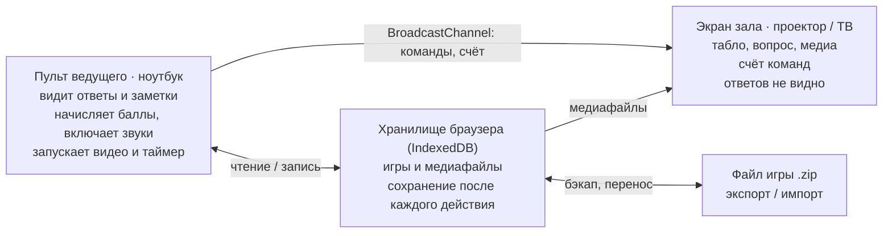

# План разработки: конструктор «Своей игры»

Обновлено: 12.11.2026

## Статус

**Этап 0 — Подготовка** завершён (кроме макетов редакторов — они нужны к Этапу 2). Идёт **Этап 1 — Игровой движок**: пульт и экран зала работают; осталась пробная игра. Проект: `C:\Projects\svoya-igra`, [холст с макетами](https://claude.ai/artifact/5L1s5AfnR4t2r5CKrXsWF5).

Как вести документ:

- Статус этапа меняется в таблице «Этапы разработки» (колонка «Статус»).
- Задачи внутри этапа отмечаются галочками.
- Любое изменение плана записывается одной строкой в «Журнал изменений» в конце документа.

## Цель и ключевые решения

Цель — конструктор, в котором любой человек без технических навыков (наша команда, коллеги, друзья) за несколько минут собирает «Свою игру» со своими категориями и проводит её на большом экране. Пользователю нужны только браузер и ссылка; Node.js, VS Code и Git нужны лишь разработчику.

| Решение | Выбор | Почему |
| --- | --- | --- |
| Кто собирает игры | Мы, коллеги и друзья — без технических навыков | Без аккаунтов: игры хранятся в браузере, передаются файлом .zip. Клиенты-самообслуживание (аккаунты, облако) — возможный этап после запуска |
| Формат проведения | Один большой экран, ведущий управляет с ноутбука | Команды отвечают голосом, телефоны не нужны |
| Сервер | Не нужен на первых этапах | Всё работает в браузере, даже без интернета на площадке |
| Стиль | Чёрно-белый + по желанию один фирменный цвет клиента | Выбираем для каждой игры отдельно |
| Разработка | Самостоятельно, с помощью ИИ | Популярный стек, на котором ИИ пишет код лучше всего |
| Браузер для игр | Chrome | Один браузер — меньше сюрпризов с видео и хранилищем |

## Требования

Конструктор должен покрывать четыре задачи: собрать игру, оформить под клиента, распределить людей и провести игру.

### Команды и игроки

- От 1 до 10 команд в игре; размер команд может быть разным.
- Список участников вводится вручную или вставкой списка имён.
- Распределение по командам: вручную (перетаскиванием) или случайно.
- Случайное распределение не привязано к равным командам: можно задать размер каждой команды (например, 5, 4 и 3 человека) или оставить пустым — тогда люди расходятся примерно поровну.
- Часть игроков можно закрепить за командой заранее (например, капитанов), остальных распределить случайно.
- После распределения состав можно поправить руками или перемешать заново; равенство команд не проверяется.
- Каждая команда: название, номер, счёт.
- У каждого участника имя и фото (загружается с компьютера). Ведущий заполняет их перед игрой и может менять во время игры — изменения сразу видны в зале.
- Два вида команд на экране зала, переключаются на пульте:
    - **Имена + фото** — команды с фото и именами игроков; фото можно свернуть, оставив только имена.
    - **Номера / названия** — компактная полоса: номер команды и её название.
- Отвечающая команда подсвечивается на всех экранах (рамка акцентного цвета + плашка «Отвечает»).

### Контент вопросов

- Текст, картинки, GIF, видео, аудио — и в вопросе, и в ответе.
- Замена любого медиафайла в один клик.
- Типы вопросов: обычный, «кот в мешке», аукцион, финальный со ставками.
- Типы раундов: обычный, музыкальный, финальный.
- Количество раундов и категорий задаётся свободно; в категории до 10 вопросов, готовые сетки на 5, 8 и 10 вопросов, по умолчанию 10.

### Звук

- Основа: сигналы «правильно» и «неправильно», запускает ведущий.
- Музыка — только в музыкальных раундах (фрагмент трека как вопрос).
- Звуки можно заменить своими и отключить целиком.

### Оформление под компанию

- Логотип, фоновая картинка, заставка.
- Режим цвета: ч/б или ч/б + один фирменный акцент.
- Фон из 5 тонов, переключается на пульте прямо во время игры: графит #26272B (по умолчанию), мокрый асфальт #2F3440, тёплый серый #3A3632, средний серый #4A4A4A, светлый с инверсией #F2F2EF.
- Шрифт заголовков и номиналов из 8, тоже переключается во время игры: Rubik Mono One (по умолчанию), Tektur, Press Start 2P, Oswald, Rubik Glitch, Playfair Display, JetBrains Mono, Jura. Текст вопросов всегда в Inter.
- Переключатель «обесцветить медиа».

### Дерево решений

- **Ветвящийся вопрос**: дерево прикрепляется к конкретной ячейке табло, а не ко всей игре. От ответа зависит следующий уточняющий вопрос или сцена; после конца ветки игра возвращается к табло.
- Отвечает одна команда — та, что выбрала ячейку: она идёт по ветке и получает баллы. Кнопки на пульте нажимает ведущий.
- Тип ветвления — настройка вопроса:
    - **По выбору варианта** (по умолчанию): команда называет А, Б или В, ведущий нажимает его, и у каждого варианта свой следующий шаг.
    - **По правильности ответа**: ведущий нажимает «верно» или «неверно»; верный ответ ведёт в одну ветку (например, сложный вопрос), неверный — в другую (утешительный).
- Пример: вопрос за 400 «Клиент недоволен сроками. Что делаете?» → по каждому варианту свой уточняющий вопрос и свои баллы.
- Дерево может связывать несколько ячеек: например, верный ответ на вопрос за 300 открывает скрытый вопрос в другой категории.
- Баллы начисляются за каждый шаг ветки или один раз в конце — выбирается в самом вопросе.
- **Правила хода игры**: «ЕСЛИ условие → ТО действие», например: если команда набрала 1000 — открыть бонусный раунд.

## Архитектура и стек

Всё работает в Chrome на ноутбуке ведущего: два окна одного приложения, сервер и интернет на площадке не нужны.



Ведущий открывает пульт, нажимает «Открыть экран для зала» и перетаскивает второе окно на проектор; окна обмениваются командами через встроенный в браузер BroadcastChannel.

| Задача | Инструмент | Почему |
| --- | --- | --- |
| Основа | React + TypeScript + Vite | Самая популярная связка, ИИ пишет её лучше всего |
| Стили | Tailwind CSS | Быстро, под ч/б стиль подходит идеально |
| Состояние игры | Zustand | Проще Redux, мало кода |
| Хранение игр и медиа | Dexie (IndexedDB) | Хранит видео и картинки прямо в браузере |
| Синхронизация окон | BroadcastChannel | Встроен в браузер, ничего устанавливать не надо |
| Перетаскивание | dnd-kit | Категории, вопросы, игроки по командам |
| Дерево решений | React Flow | Готовый редактор узлов и связей |
| Экспорт / импорт | JSZip | Игра со всеми медиа в одном файле |
| Публикация | Netlify или GitHub Pages | Бесплатно; данные остаются на ноутбуке |

## Модель данных

Поля для ветвления и правил закладываем сразу, даже пустыми: тогда на Этапе 7 не придётся переделывать хранение. Этот блок можно целиком отдать ИИ как стартовую точку (файл `types.ts`).

```typescript
type Game = {
  id: string; title: string; client: string; date?: string;
  theme: Theme;
  players: Player[];          // все участники
  teams: Team[];              // 1–10 команд, разного размера
  rounds: Round[];
  rules: Rule[];              // ЕСЛИ → ТО
};

type Theme = {
  logo?: MediaRef; background?: MediaRef;
  accentColor?: string;       // пусто = строгий ч/б
  backgroundTone: 'graphite' | 'asphalt' | 'warm-gray' | 'mid-gray' | 'light';
  headingFont: string;        // один из 8 шрифтов, по умолчанию 'Rubik Mono One'
  teamView: 'photos' | 'compact';
  showPhotos: boolean;        // false = фото свёрнуты, только имена
  grayscaleMedia: boolean;
  sounds: { correct?: MediaRef; wrong?: MediaRef; enabled: boolean };
};

type Player = {
  id: string; name: string;
  photo?: MediaRef;
  teamId?: string;
  locked?: boolean;           // закреплён, случайное распределение его не трогает
};

type Team = {
  id: string; name: string; icon: string; score: number;
  targetSize?: number;        // желаемый размер; пусто = примерно поровну
};

type Round = {
  id: string; title: string;
  kind: 'standard' | 'music' | 'final';
  categories: Category[];
};

type Category = { id: string; title: string; questions: Question[] };

type Question = {
  id: string; value: number;
  kind: 'normal' | 'cat-in-bag' | 'auction';
  slides: Content[];          // слайды по порядку: задание → картинка / музыка / видео; минимум один
  answer: Content;
  timerSec?: number; hostNote?: string;
  hidden?: boolean;           // скрыт, пока дерево или правило его не откроет
  tree?: QuestionTree;        // дерево решений этого вопроса
  played: boolean;
};

type Content  = { text?: string; media?: MediaRef };
type MediaRef = { id: string; type: 'image' | 'gif' | 'video' | 'audio'; name: string };

// Дерево решений — внутри одного вопроса
type QuestionTree = {
  startNodeId: string;
  branchBy: 'choice' | 'correctness'; // по умолчанию 'choice'; 'correctness' = два варианта: верно / неверно
  scoring: 'per-step' | 'at-end';
  nodes: TreeNode[];
};

type TreeNode = {
  id: string; kind: 'question' | 'scene' | 'end';
  content: Content; answer?: Content;
  options: {
    label: string; points: number;
    nextNodeId?: string;        // следующий шаг ветки
    unlockQuestionId?: string;  // открыть скрытую ячейку на табло
  }[];
};

// Правила хода игры
type Rule = {
  id: string;
  when: { kind: 'score-reached' | 'round-finished' | 'question-played'; value: string | number };
  then: { kind: 'open-round' | 'unlock-question' | 'add-points' | 'show-media'; target: string };
};
```

Медиафайлы хранятся отдельной таблицей в IndexedDB (`media`: id, тип, имя, сам файл), а в игре лежит только ссылка `MediaRef`. Так замена картинки не трогает остальную игру.

Вопрос состоит из слайдов: например, первый — «Найдите на картинке звезду», второй — сама картинка; или «Угадайте мелодию» → музыка. Ведущий листает слайды стрелками ← / →, зал показывает текущий. Музыка играет из окна пульта: браузер разрешает звук там, где ведущий кликает, а в колонки проектора звук идёт одинаково из любого окна.

## Интерфейс

Шесть экранов: четыре для подготовки игры, два для проведения. Готовы макеты пульта, экрана зала, «Команды и игроки», стартового экрана «Мои игры» и шага 2 «Быстрой игры»: [холст с макетами](https://claude.ai/artifact/5L1s5AfnR4t2r5CKrXsWF5).

**Табло:** категории идут строками (их может быть много), номиналы — справа от названия категории. Сыгранные ячейки — пустая пунктирная рамка.

**Предпросмотр:** отдельный режим на пульте (кнопка над табло или клавиша P). Пока он включён, клик по ячейке показывает вопрос, медиа и ответ только ведущему; предпросмотр никогда не попадает в зал. Режим выключен — клик по ячейке играет вопрос. Есть кнопка «Скрыть экран зала» — выводит заставку.

**Быстрая игра:** мастер из 3 шагов — название и оформление → вопросы → команды. Вопросы вводятся одной таблицей (категория, стоимость, вопрос, ответ, медиа) или вставляются из Excel / Google Таблиц через Ctrl+V; есть пустой шаблон таблицы для скачивания; конструктор подсвечивает недочёты («вопрос без ответа»). Команды можно пропустить и сразу играть. Сложные настройки (спецвопросы, деревья, музыкальные раунды) — только в полном редакторе.

| Экран | Где открыт | Что на нём |
| --- | --- | --- |
| 1. Мои игры (старт) | Ноутбук | «Быстрая игра», «Из шаблона», «Открыть файл игры»; список игр с «Играть», «Изменить», «Отправить файлом» |
| 1а. Быстрая игра | Ноутбук | Мастер из 3 шагов, вопросы таблицей со вставкой из Excel |
| 2. Редактор игры | Ноутбук | Слева раунды, справа сетка «категории × стоимость»; клик по ячейке открывает редактор вопроса с зоной для медиа |
| 3. Редактор дерева | Ноутбук | Открывается из редактора вопроса: полотно с узлами и стрелками-вариантами; список правил «ЕСЛИ → ТО» |
| 4. Команды и игроки | Ноутбук; открывается и во время игры кнопкой «Изменить игроков» | Участники: фото, имя, команда, «капитан»; команды: название, размер, игроки; «Распределить случайно» |
| 5. Пульт ведущего | Ноутбук | Табло, предпросмотр вопроса, ±баллы по командам, звуки верно/неверно, видео, таймер; в шапке — фон, шрифт, вид команд, «Скрыть экран зала» |
| 6. Экран зала | Проектор / ТВ | Табло со строками-категориями и командами (с фото или компактно), вопрос с медиа и таймером, подсветка отвечающей команды; ответов не видно |

### Горячие клавиши пульта

- P — режим предпросмотра (только пульт); клик по ячейке — сыграть вопрос или посмотреть его в предпросмотре.
- ← / → — предыдущий / следующий слайд вопроса.
- Пробел — показать ответ; Esc — вернуться к табло.
- 1–9 и 0 — выбрать команду (0 = десятая).
- + / − — начислить или снять баллы со звуком «верно/неверно».
- Ctrl+Z — отменить последнее действие.
- H — скрыть / показать экран зала (заставка).

### Стиль

- Тёмно-серый фон (по умолчанию графит), белый текст; акцент — инверсия (белая ячейка, чёрный текст).
- Фирменный цвет клиента (если выбран) заменяет только акцент: выбранная ячейка, отвечающая команда.
- Сыгранные ячейки — пустая пунктирная рамка.
- Шрифты: Rubik Mono One (или другой из 8) для заголовков и номиналов, Inter для текста вопросов; текст читается с последнего ряда.
- Раскладка под 16:9, проверка на 1280×720 и 1920×1080.

## Этапы разработки

Девять этапов, примерно 14–20 недель в режиме вечеров и выходных. После Этапа 1 уже можно провести пробную игру.

Статусы: Не начат · В работе · Готово · Отложен

| Этап | Результат | Оценка, нед. | Статус |
| --- | --- | --- | --- |
| 0. Подготовка | Макеты экранов + пустой проект | 1 | Готово |
| 1. Игровой движок | Игра из готового файла, два окна | 2–3 | В работе |
| 2. Редактор | Игра собирается мышкой, автосохранение | 2–3 | Не начат |
| 3. Медиа и звук | Картинки, GIF, видео, аудио, сигналы верно/неверно | 1–2 | Не начат |
| 4. Команды и игроки | 1–10 команд, ручное и случайное распределение | 1 | Не начат |
| 5. Оформление | Логотип, фон, акцент, анимации | 1 | Не начат |
| 6. Спецвопросы и раунды | Кот в мешке, аукцион, музыкальный и финальный раунды | 1–2 | Не начат |
| 7. Дерево и правила | Ветвящиеся вопросы, правила «ЕСЛИ → ТО» | 2–3 | Не начат |
| 8. Надёжность и тест | Экспорт/импорт, репетиция, тест на проекторе | 1–2 | Не начат |

### Этап 0. Подготовка

- [x] Установить Node.js (LTS, v26), VS Code, Git, завести аккаунт GitHub
- [x] Макеты пульта, экрана зала (табло, вопрос) и экрана «Команды и игроки»
- [x] Макеты стартового экрана «Мои игры» и шага 2 «Быстрой игры»
- [ ] Макеты шагов 1 и 3 «Быстрой игры», полного редактора и редактора дерева
- [x] Утвердить модель данных (`src/types.ts`)
- [x] Создать проект Vite + React + TypeScript + Tailwind, первый коммит
- [x] Тестовая игра: 1 раунд × 6 категорий × 5 вопросов (`src/data/demoGame.ts`)

### Этап 1. Игровой движок

- [x] Табло: категории строками, номиналы справа
- [x] Режим предпросмотра на пульте (клавиша P); в зал никогда не попадает
- [x] Экран вопроса и показ ответа; «Скрыть экран зала» (H)
- [x] Счёт команд, кнопки ±баллы, отмена последнего действия (Ctrl+Z)
- [x] Два окна: пульт и экран зала, синхронизация через BroadcastChannel
- [x] Горячие клавиши: P, Пробел, Esc, 1–9/0 (отвечающая команда), + / −, Ctrl+Z, H
- [x] Подсветка отвечающей команды на пульте и в зале
- [x] Состояние игры переживает случайное закрытие вкладки
- [ ] Пробная игра на друзьях

### Этап 2. Редактор

- [ ] Стартовый экран «Мои игры»: создать, переименовать, дублировать, удалить, «Отправить файлом»
- [ ] Мастер «Быстрая игра» (3 шага) с пропуском шага «Команды»
- [ ] Таблица вопросов со вставкой из Excel / Google Таблиц (Ctrl+V) и пустым шаблоном для скачивания
- [ ] Проверка игры: вопросы без ответа, пустые категории, повторы стоимости
- [ ] Шаблоны игр: «Новый год», «Онбординг», «День рождения компании»
- [ ] Раунды и категории: добавить, удалить, перетащить (готово для категорий — кнопками ↑ ↓; осталось: раунды)
- [ ] Редактор вопроса: текст, ответ, стоимость, таймер, заметка ведущему (готово: слайды, ответ, стоимость, добавить и удалить вопрос; осталось: таймер, заметка)
- [x] Хранение в IndexedDB (Dexie), автосохранение
- [ ] Кнопка «Предпросмотр» с любого вопроса

### Этап 3. Медиа и звук

- [x] Загрузка перетаскиванием или кнопкой: картинки, GIF, видео, аудио
- [x] Замена и удаление файла, лимит размера (200 МБ) с подсказкой
- [ ] Управление видео и аудио с пульта (play/pause/громкость)
- [ ] Сигналы «верно/неверно», замена на свои
- [ ] Заставка «Нажмите, чтобы начать» на экране зала (разрешает звук)
- [ ] Предзагрузка медиа перед игрой

### Этап 4. Команды и игроки

- [x] Список участников: ввод по одному и вставка списка
- [ ] От 1 до 10 команд: название и значок (готово: экран `#/teams/<id>` — название, порядок, добавить, удалить; осталось: значок)
- [x] Ручное распределение перетаскиванием (и выбором команды в списке, и «+ игрок» прямо в карточке команды)
- [x] Случайное распределение: по заданным размерам команд или примерно поровну, с закреплёнными игроками + «перемешать заново»
- [x] Фото участников: загрузка, замена; правка имён и фото во время игры
- [ ] Два вида команд в зале: «имена + фото» (со сворачиванием фото) и «номера / названия»
- [ ] Подсветка отвечающей команды на всех экранах
- [ ] Показ распределения на экране зала с анимацией

### Этап 5. Оформление

- [ ] Логотип, фон, заставка игры
- [ ] Режим «ч/б» и «ч/б + акцент» с выбором цвета
- [ ] 5 тонов фона с переключением на пульте во время игры
- [ ] 8 шрифтов заголовков с переключением на пульте во время игры
- [ ] Переключатель «обесцветить медиа»
- [ ] Анимации переходов (открытие вопроса, смена счёта)

### Этап 6. Спецвопросы и раунды

- [ ] «Кот в мешке»: передача вопроса другой команде
- [ ] Аукцион: ввод ставок ведущим
- [ ] Музыкальный раунд: фрагмент трека, обрезка старта и конца
- [ ] Финальный раунд: убирание тем, ставки, одновременное раскрытие

### Этап 7. Дерево и правила

- [ ] Редактор дерева на React Flow, открывается из вопроса
- [ ] Настройка вопроса «Тип ветвления»: по выбору варианта (по умолчанию) или по правильности ответа
- [ ] Прохождение ветвящегося вопроса на пульте и экране, возврат к табло
- [ ] Связь между ячейками: ответ открывает скрытый вопрос
- [ ] Проверка дерева: тупики, недостижимые узлы, циклы
- [ ] Редактор правил «ЕСЛИ → ТО» и их срабатывание в игре

### Этап 8. Надёжность и тест

- [ ] Экспорт и импорт игры одним .zip со всеми медиа
- [ ] Режим репетиции: проверка всех вопросов и медиа перед игрой
- [ ] Тест на настоящем проекторе и ТВ
- [ ] Публикация на Netlify или GitHub Pages

## Риски и решения

| Риск | Что происходит | Решение |
| --- | --- | --- |
| Автозапуск звука | Браузер блокирует видео и звуки до первого клика в окне | Заставка «Нажмите, чтобы начать» на экране зала |
| Большие видео | Место в браузере заканчивается, игра тормозит | Лимит на файл, подсказка про сжатие (HandBrake); позже — работа с папкой на диске |
| Потеря данных | Очистка браузера стирает игры | Экспорт в .zip + напоминание о бэкапе |
| Сбой во время игры | Закрылась вкладка — пропал счёт | Состояние игры сохраняется после каждого действия |
| Разные экраны | На проекторе обрезается или мелко | Масштабируемая раскладка 16:9, тест на двух разрешениях |
| Затягивание проекта | Без опыта легко застрять на мелочах | Короткие этапы с рабочим результатом; одна задача — один запрос к ИИ |

## Открытые вопросы и идеи

### Открытые вопросы

- [ ] Нужен ли отдельный режим «каждый сам за себя», когда команда = один человек?
- [ ] Какие правила хода игры нужны в первую очередь? Собрать 3–5 реальных примеров.
- [ ] Сроки рассчитаны на вечера и выходные — подтвердить.

### Идеи на потом

- Аккаунты и облачное хранение игр — если конструктор откроем клиентам для самостоятельной работы.
- Черновик вопросов от ИИ по описанию компании.
- Итоговый слайд с победителем и статистикой для отправки клиенту.
- Импорт списка участников из Excel/CSV.
- Распределение с условием «коллеги из одного отдела — в разные команды».
- Пульт ведущего с телефона (потребует сервера).

## Журнал изменений

| Дата | Изменение |
| --- | --- |
| 15.11.2026 | В категории до 10 вопросов; готовые сетки 5 / 8 / 10 в редакторе (заполненные вопросы, которые не влезают, удаляются только после подтверждения); новая категория — по текущей сетке, в пустой игре — 10. Номиналы на табло уменьшаются под ширину ячейки. На пульте — кнопка «Команды и игроки», в «Моих играх» — «Команды» |
| 15.11.2026 | Участники по макету: общий список (имя, фото, команда, капитан, «Вставить списком»), плашки игроков в карточках команд, перетаскивание, «+ игрок» в карточке, размер команды, «Распределить случайно», блок «Без команды» |
| 15.11.2026 | Экран «Команды и игроки» (`#/teams/<id>`), пока только команды: название, порядок, добавить и удалить (1–10). Открывается из редактора и с пульта; счёт партии при правке команд сохраняется |
| 15.11.2026 | Редактор: название игры, категории (добавить, переименовать, переставить, удалить), вопросы (добавить, удалить, стоимость с предупреждением о повторе). «Мои игры»: «Дублировать»; при удалении игры удаляются её ненужные файлы |
| 15.11.2026 | Редактор игры (`#/edit/<id>`, кнопка «Изменить» в «Моих играх»): клик по ячейке — редактор вопроса со слайдами, ответом и загрузкой своих файлов. Часть Этапа 3 (загрузка, замена, удаление файлов) сделана раньше Этапа 2. Правки не сбрасывают начатую партию |
| 13.11.2026 | Вопрос из нескольких слайдов (`prompt` → `slides`): задание, затем картинка или музыка; листание ← / →. Таблица `media` для файлов. На пульте: ±баллы кнопками и ввод счёта вручную |
| 13.11.2026 | Этап 0 завершён: Node.js 26, VS Code, Git, проект Vite + React + TS + Tailwind. Этап 1: табло, вопросы, счёт, пульт + экран зала, предпросмотр, отмена, выбор и подсветка отвечающей команды, заставка. Осталась пробная игра |
| 12.11.2026 | Игры собирают коллеги и друзья без тех. навыков: стартовый экран «Мои игры», мастер «Быстрая игра», вопросы таблицей со вставкой из Excel, шаблоны. Предпросмотр — отдельный режим (P), кнопка «Открыть в зале» убрана |
| 12.11.2026 | Одобрены макеты пульта, экрана зала и «Команды и игроки»: категории строками, тайный предпросмотр, два вида команд с фото, смена фона (5 тонов) и шрифта (8) во время игры, правка игроков в игре |
| 12.11.2026 | В ветвящемся вопросе отвечает команда, выбравшая ячейку; тип ветвления — по выбору варианта (по умолчанию) или по правильности ответа |
| 11.11.2026 | Команды могут быть разного размера; дерево решений прикрепляется к отдельным вопросам, сюжетный раунд убран |
| 11.11.2026 | Добавлены команды 1–10 с ручным и случайным распределением (Этап 4), музыкальный раунд, звуки верно/неверно, фирменный акцент по выбору |
| 06.11.2026 | Первая версия плана: внутренний инструмент, один экран, без сервера |
